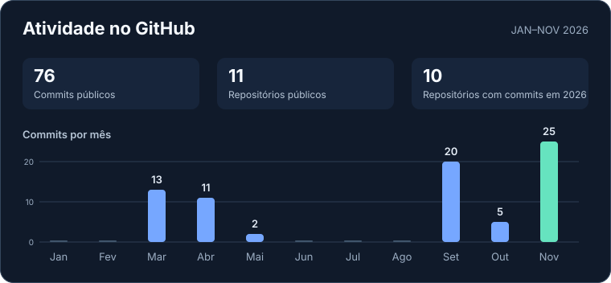

# Olá, eu sou o Daniel dos Santos 👋

**Estudante de Análise e Desenvolvimento de Sistemas na UDF | Dados, SQL e IA aplicada**

Meu portfólio reúne projetos acadêmicos em que modelo bancos de dados, escrevo consultas em SQL e experimento automações com IA em notebooks. Tenho interesse em oportunidades de estágio nas áreas de dados e desenvolvimento.

[Projetos em destaque](#projetos-em-destaque) · [Atividade no GitHub](#atividade-no-github)

## Projetos em destaque

### 🗄️ Bancos de dados em MySQL

Desenvolvi bancos de dados para Fórmula 1, uma locadora de veículos e uma biblioteca. No exemplo da biblioteca, modelei a relação entre livros e autores e escrevi consultas com `JOIN`, subconsultas e uma procedure para consultar preços.

**MySQL · SQL · Modelagem relacional**  
[Ver repositório](https://github.com/vismoke777/PROJETOS-SQL) · [Ver código da biblioteca](https://github.com/vismoke777/PROJETOS-SQL/blob/main/biblioteca%20MySql)

### 🧩 Modelagem de dados com BRModelo

Criei modelos conceituais para cenários como uma delegacia, um casamento e um departamento. Os arquivos editáveis mostram as entidades, os atributos e os relacionamentos de cada exercício.

**BRModelo · Diagramas entidade-relacionamento**  
[Ver repositório](https://github.com/vismoke777/PROJETOS-BRMODELO) · [Abrir material em PDF](https://github.com/vismoke777/PROJETOS-BRMODELO/blob/main/BR.MODELO.pdf)

### 🤖 Engenharia de prompt e automação com IA

Reuni atividades de engenharia de prompt, programação assistida e automação com IA. Os notebooks documentam a parte prática do estudo.

**Python · Jupyter · IA generativa**  
[Ver repositório](https://github.com/vismoke777/eng.prompt.fundamentos) · [Abrir notebook de automação](https://github.com/vismoke777/eng.prompt.fundamentos/blob/main/Aula8_AutomacaoIA.ipynb)

### 🌐 Estudos de desenvolvimento web

Criei esboços de páginas em HTML e CSS e reuni exercícios de front-end com JavaScript e Bootstrap.

**HTML · CSS · JavaScript · Bootstrap**  
[Ver exemplos de HTML e CSS](https://github.com/vismoke777/HTML-E-CSS) · [Ver exercícios de front-end](https://github.com/vismoke777/Projetos-de-Treinos)

## Tecnologias e ferramentas

**Dados e IA**

**Desenvolvimento**

## Formação complementar

- [MongoDB CRUD](https://github.com/vismoke777/Certificado---DBSKILL)
- [Introdução à Análise de Dados com Microsoft Power BI](https://github.com/vismoke777/Certificado-INTRODU-O-AN-LISE-DE-DADOS)

## Atividade no GitHub

Dados coletados em 20 de novembro de 2026. O gráfico conta commits da conta nas branches padrão dos repositórios públicos. O calendário do GitHub também inclui outros tipos de contribuição.

[Ver calendário atualizado](https://github.com/vismoke777#contributions-calendar) · [Explorar todos os repositórios](https://github.com/vismoke777?tab=repositories)
